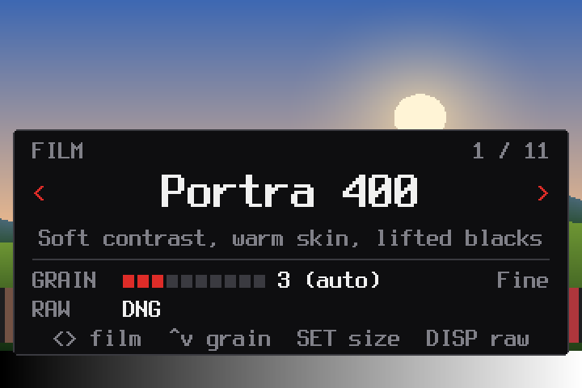
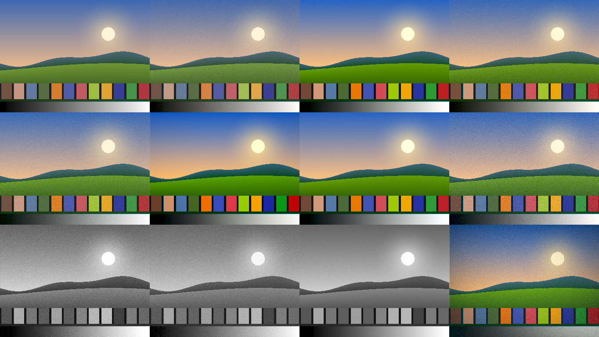

# chdk-film

A film simulator for the Canon PowerShot A570 IS, built on [CHDK](https://chdk.fandom.com/wiki/CHDK).

Pick a film stock and every JPEG the camera takes is developed through it: tone curve, colour response, grain and vignette. RAW (DNG or CRW) still works and is saved *before* the film look is applied, so the raw file stays clean.

**[Installation guide →](INSTALL.md)**

Like stock CHDK it runs from the SD card only. Nothing is written to the camera, so taking the card out (or unlocking it) gives you a stock camera back.

## Film stocks

| Stock | Look |
|---|---|
| Portra 400 | soft contrast, warm highlights, lifted blacks, gentle saturation |
| Ektar 100 | punchy, saturated, fine grain |
| Gold 200 | warm golden highlights, consumer-film colour |
| Superia 400 | green-leaning shadows, cooler highlights |
| Velvia 50 | very saturated slide film, deep contrast, light vignette |
| Ektachrome E100 | clean slide film with cool blues |
| Cinestill 800T | tungsten film: teal shadows, heavier grain |
| Tri-X 400 | contrasty black and white, classic grain |
| HP5 Plus | softer black and white, coarse grain |
| T-Max 100 | smooth, fine-grained black and white |
| Expired Lomo | faded, cross-processed tints, heavy vignette and grain |

## On the camera

### Film picker

Press **Print** in shooting mode and a film picker appears:



| Key | Does |
|---|---|
| ◀ ▶ | change film (grain resets to that film's own) |
| ▲ ▼ | grain amount, Off to 10 |
| SET | grain size: fine, medium, coarse |
| DISP | RAW: Off, DNG, CRW |
| MENU | all settings |
| Print | back to shooting |

### Developing

The screen goes dark while the camera captures, so the blue **Print** light blinks while the film is developed, getting faster as it nears done.

### Menu

Print, then **MENU**:

- **FILM**: Film stock, Grain (`auto` uses the film's own amount), Grain size, Vignette (`Auto` = only films that have one)
- **CAPTURE**: Save RAW (Off / DNG / CRW); Auto camera colour (sets Canon *My Colors* to suit the film, e.g. B/W for Tri-X. Use **P** mode: Auto ignores My Colors)
- **SCREEN**: Film badge (film, grain, RAW, battery and free card space in one pill at the top; replaces CHDK's separate battery/space/RAW indicators), Blink light while developing
- **All CHDK settings**: the full stock CHDK menu

Each shot takes a second or two longer to save while the film is developed.

## How the film simulation works



*Off, Portra 400, Ektar 100, Gold 200 / Superia 400, Velvia 50, Ektachrome E100, Cinestill 800T / Tri-X 400, HP5 Plus, T-Max 100, Expired Lomo. Rendered by `film-tools/host/preview` from a synthetic scene with a simulated A570 raw frame.*

### Where it runs

CHDK has no JPEG encoder, so the film look can't be applied to finished photos. Instead it is applied to the **sensor data**, in the gap between capture and Canon's own processing:

```
sensor ──► raw buffer ──► CHDK raw hook ─────────────────────────────► Canon pipeline ──► JPEG
          (10-bit Bayer)   1. save DNG / CRW  (untouched)              demosaic, white balance,
                           2. film_apply()    (core/film.c)            My Colors, sharpening
```

Canon then demosaics, white-balances, sharpens and compresses the modified data as if the sensor had seen it that way. Because the RAW file is written **before** `film_apply()`, it stays a clean negative of the scene.

### The raw data

| | A570 IS |
|---|---|
| Sensor buffer | 3152 × 2340, 10-bit, packed 8 pixels per 10 bytes |
| Colour filter | RGGB Bayer (`cfa_pattern 0x02010100`) |
| Black / white level | 32 / 1023 |
| Processed area | the active area (38,14)–(3146,2338), aligned to 8-pixel groups and even rows |

Only the active area is touched. The masked optical-black border is left alone so Canon's own black-level measurement isn't skewed by the film's lifted blacks or grain.

The code works on **2×2 Bayer quads** (one R, two G, one B), about 1.8 million per shot. Each quad goes through the steps below. Everything is integer maths in Q12 fixed point (4096 = 1.0), since the camera's ARM946 has no floating-point unit.

### 1. White balance

Raw sensor data is strongly green-tinted. Saturation and grain both need to know what "neutral" is, so before processing, `film_apply()` estimates white balance with a **grey-world** average. It samples a sparse grid (every 16th row pair, every 4th 8-pixel group), skips clipped and near-black quads, and computes

```
gain_R = ΣG / ΣR      gain_B = ΣG / ΣB        (clamped to 0.5 … 4)
```

Each quad is multiplied by these gains on the way in and divided by them on the way out. Canon's auto white balance therefore still decides the final colour of the JPEG.

### 2. Vignette

A separable falloff, cheap enough to run per quad:

```
v = (1 − k·dx²) · (1 − k·dy²)        dx, dy ∈ [−1, 1] from the frame centre
```

`k` is per stock: 0.10 for Velvia, 0.45 for Expired Lomo, 0 for the rest.

### 3. Saturation

Each channel is pushed towards or away from the quad's luminance:

```
L  = (77·R + 76·G₁ + 75·G₂ + 28·B) / 256         (≈ 0.30 R + 0.59 G + 0.11 B)
c' = L + s · (c − L)
```

`s` ranges from 0.90 (Portra) to 1.30 (Velvia), and is 0 for the black-and-white stocks. Those also switch Canon's My Colors to B/W, so the camera's own colour processing can't reintroduce a tint.

### 4. Grain

Film grain is clumps of silver or dye. It's the same in every colour layer and strongest in the mid-tones. The simulation copies both properties:

- **Noise source:** a 32-bit xorshift generator. Summing its four bytes gives a roughly Gaussian value (σ ≈ 147), seeded from the shot's timestamp.
- **Monochrome:** the same value is added to all four photosites of a quad, so grain varies in brightness, not colour.
- **Grain size** comes from a recursive filter over neighbouring quads (left, and the row above):

  | Size | Filter | Gain |
  |---|---|---|
  | Fine | independent per quad (2 px) | 1 |
  | Medium | `n = (2·x + left + up) / 4` | ×1.6 |
  | Coarse | `n = (x + 2·left + 2·up) / 5` | ×2.4 |

  The gains bring the filtered noise back to about the same strength.
- **Tone-dependent strength:** grain is defined in perceptual units and converted to linear sensor values:

  ```
  p      = √(L / W)                                   perceptual level of the quad
  σ_p    = amount × 0.45% × (0.35 + 2.6 · p · (1 − p)) peaks at mid grey, 35% in shadows/highlights
  σ_lin  = 2 · p · W · σ_p                            derivative of x = p²·W
  ```

  A 256-entry table indexed by luminance stores this, so the inner loop is one multiply.

### 5. Tone curves

Each stock gets three 4096-entry lookup tables (R, G, B) over white-balanced linear values, rebuilt only when the stock changes. They are built in a gamma-2 perceptual space, so contrast and tints behave as they would on a print:

```
p   = √(x / W)                                  linear → perceptual
s   = p + c · 4 (p − p₀) · p (1 − p)            S-curve around mid grey, p₀ = 0.425 (≈ 18% grey)
s   = lift + s · (white − lift)                 faded blacks, muted whites
s_c = s + shadow_c · (1 − s)² + highlight_c · s² per-channel split toning
x_c = s_c² · W                                  perceptual → linear
```

The S-curve stays monotonic for `c ≤ 0.4`. Tints act on the shadows and highlights separately: Portra warms its highlights (+R, −B), Cinestill 800T pushes its shadows teal (+G, +B), and Superia's shadows lean green.

### 6. Back to the sensor

White-balance gains are divided back out, black level is added, and the values are clamped to 0…1023 and repacked into the 10-bit buffer in place.

### Camera colour

Each stock can also set Canon's **My Colors** mode (propcase 184), which Canon applies later in its pipeline:

| My Colors | Stocks |
|---|---|
| B/W | Tri-X 400, HP5 Plus, T-Max 100 |
| Positive Film | Velvia 50 |
| Vivid | Ektar 100 |
| Off | everything else |

It is set when chdk-film starts and whenever you change stock, so a manual change in Canon's menu stays until the next one. Canon ignores My Colors in Auto mode.

### Stock parameters

| Stock | Saturation | Contrast | Lift | White | Shadow tint (R, G, B) | Highlight tint (R, G, B) | Grain | Vignette |
|---|---|---|---|---|---|---|---|---|
| Portra 400 | 0.90 | 0.08 | 0.030 | 0.975 | +.010 +.004 −.004 | +.016 +.006 −.018 | 3 fine | – |
| Ektar 100 | 1.15 | 0.18 | 0 | 1 | −.004 0 +.010 | +.010 +.004 −.008 | 1 fine | – |
| Gold 200 | 1.05 | 0.12 | 0.020 | 0.985 | +.012 +.006 −.006 | +.026 +.014 −.030 | 3 fine | – |
| Superia 400 | 1.00 | 0.12 | 0.025 | 0.980 | −.010 +.012 +.006 | 0 +.004 +.006 | 4 fine | – |
| Velvia 50 | 1.30 | 0.28 | 0 | 1 | −.004 −.006 +.012 | +.006 0 −.006 | 1 fine | 0.10 |
| Ektachrome E100 | 1.12 | 0.20 | 0 | 1 | −.006 0 +.016 | −.004 +.002 +.012 | 1 fine | – |
| Cinestill 800T | 1.00 | 0.14 | 0.020 | 0.985 | −.012 +.010 +.030 | +.012 0 −.004 | 6 medium | – |
| Tri-X 400 | 0 | 0.25 | 0.010 | 1 | – | – | 6 medium | – |
| HP5 Plus | 0 | 0.12 | 0.030 | 0.980 | – | – | 7 coarse | – |
| T-Max 100 | 0 | 0.15 | 0 | 1 | – | – | 2 fine | – |
| Expired Lomo | 1.20 | 0.25 | 0.060 | 0.950 | −.016 +.010 +.020 | +.024 +.016 −.024 | 7 coarse | 0.45 |

Tints are in perceptual units: 0.010 is 1% of the tonal range. To add a stock, add a row to `film_stocks[]` in `core/film.c`, then check it with the host preview before building.

### Cost

| | |
|---|---|
| Memory | 24 KB of tone tables (freed when the film is Off), 1 KB grain table, a 6 KB noise row for medium/coarse grain |
| Time | about 12 ms on an M-series Mac. Expect about 1–2 s per shot on the camera, during which the blue Print light blinks |

### Limitations

- These are **looks inspired by** each film, tuned by eye, not colorimetric emulations measured from film scans.
- Saturation and grain neutrality depend on the grey-world white balance. A frame filled with one colour (all sky, all grass) skews it slightly. The black-and-white stocks avoid this by also switching Canon to B/W.
- Grain is generated per 2×2 quad, so the finest grain is two sensor pixels across, and Canon's demosaic and sharpening soften it a little.
- Burst shooting is slower, since every frame is developed.

## Installing

See **[INSTALL.md](INSTALL.md)**. Short version:

```bash
make PLATFORM=a570 PLATFORMSUB=101a DISABLE_GCC_VERSION_CHECK=1 fir
film-tools/install-card.sh
```

then mark the card bootable once with `sudo film-tools/make-bootable.sh diskN`. After that, lock the card and chdk-film starts on its own.

## Development

### Previewing looks on a Mac

`film-tools/host` compiles the same `film.c` for the Mac:

- `preview` simulates an A570 raw frame from any image and renders every stock plus a contact sheet
- `ui_preview` draws the picker and badge at the camera's 360×240 with CHDK's font

```bash
film-tools/host/build.sh /tmp/filmprev
sips -s format bmp photo.jpg --out /tmp/in.bmp
/tmp/filmprev/preview /tmp/in.bmp /tmp/filmprev
/tmp/filmprev/ui_preview /tmp/in.bmp /tmp/filmprev
```

## Source

Based on CHDK trunk (r6346), from the [strobecat/chdk](https://github.com/strobecat/chdk) mirror of the official Assembla SVN. GPL v2, see `COPYING`.
